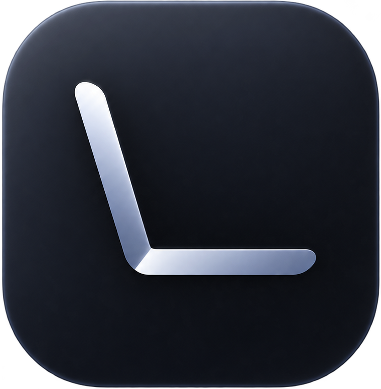

<p align="center"></p>

# Lidless

Close the lid. Your agent keeps working.

Lidless keeps your laptop awake, with everything still running, **after you
close the lid**, for as long as you choose. Start Claude Code, Codex or any
other long-running coding agent, close the lid, and keep reaching it through
remote control or SSH. When the time is up, or the agent finishes, Lidless puts
every setting back the way it was.

- **Always timed.** Sessions run for a duration you pick (up to 30 days),
  never "forever".
- **Wrap your agent:** `lidless run -- claude` keeps the Mac awake exactly as
  long as the command runs.
- **Safe by default.** Battery and temperature floors end the session before
  harm. Every change is journaled *before* it is made, and a recovery agent
  undoes it after a crash, a force-quit or a reboot.
- **Verified, not assumed.** After engaging, Lidless reads the setting back
  and re-checks it every minute. If macOS reverts it, you are told.
- **Menu bar app + CLI**, both with the same features. Every command has
  `--json` output for scripts and agents.

> **⚠️ Heat:** with the lid closed your laptop keeps running and can get warm.
> Leave it on a hard, ventilated surface. **Never run it in a bag or sleeve.**
> Lidless asks you to confirm this before your first session and again whenever
> your Mac is already warm, and it refuses to start while the Mac is critically
> hot.

Platforms: **macOS 14+** (tested on real hardware), **Windows 10/11** and
**Linux** (systemd) with the same commands, panel and window. The Windows and
Linux builds are complete but not yet validated on real laptops; see
[docs/windows-linux-validation.md](docs/windows-linux-validation.md).

---

## Install (macOS)

Requires macOS 14 or later, on Apple silicon or Intel.

1. Download **Lidless-x.y.z.dmg** from the
   [latest release](https://github.com/manasdutta04/lidless/releases/latest)
   and drag **Lidless** into **Applications**.
2. Lidless is free and open source, and not notarized by Apple. macOS blocks
   apps like that on first launch, so run this **once** in Terminal:

   ```bash
   xattr -cr /Applications/Lidless.app
   ```

   (This removes the "downloaded from the internet" flag. You can also
   right-click the app, choose **Open**, and confirm.)
3. Open **Lidless**. It lives in the menu bar and the Dock. Click **Set Up…**
   and enter your password once. That installs:
   - permission to run [four exact `pmset` commands](#privileged-commands)
     without a password, and
   - a small background helper that restores your settings if anything goes
     wrong.

   It also links the `lidless` command to `~/.local/bin/lidless`.

That's it. Pick a duration, close the lid.

Sessions start from the **menu bar panel** (click the Lidless icon), which also
extends and stops them. Opening Lidless from the Dock or Applications (or
pressing ⌘,) opens its window: **Overview** (your stats, a 12-week activity
heatmap, this week, when your Mac works, and tips), **History**, **Settings**,
**Setup** and **About & Updates**. The window is for information and settings;
it can stop a running session (Session → Stop, ⌘.) but never starts one. Closing the window keeps Lidless running
in the menu bar; only **Quit** (⌘Q, the Dock's Quit, or Quit in the panel)
exits, and quitting always ends the session and restores your settings.
"Show in Dock" can be turned off in settings.

**From the command line instead:** after step 2, run
`/Applications/Lidless.app/Contents/Helpers/lidless setup`.

**Build from source** (needs Swift 6: Xcode or `xcode-select --install`):

```bash
git clone https://github.com/manasdutta04/lidless.git
cd lidless
./macos/scripts/install.sh
```

**Uninstall:** Settings → **Uninstall…** (or `lidless uninstall`) restores
everything and removes the permission and helper. Then move Lidless.app to
the Trash. From a source checkout, `./macos/scripts/uninstall.sh` does all of
it (`--purge` also deletes logs and state).

## Install (Windows)

1. Download **Lidless-x.y.z-windows-x64.msi** from the
   [latest release](https://github.com/manasdutta04/lidless/releases/latest)
   and run it. Windows SmartScreen may warn because the installer is not
   code-signed yet: choose **More info → Run anyway**.
2. Open **Lidless** (it lives in the tray). Click **Set Up…**. Windows asks for
   administrator approval **once**. That registers:
   - two Task Scheduler tasks that run `lidless recover` every minute and at
     logon (as you, no elevation), and
   - if your account cannot change power settings directly, one task
     (`Lidless\LidAction`, highest privileges) that only applies the lid-close
     action Lidless asks for. See [Privileged operations](#privileged-operations).

How it stays awake: the active power plan's **lid-close action** is set to
*Do nothing* (AC and battery) after the original values are journaled, and a
**power request** keeps Windows from idling to sleep. Both are put back when
the session ends. Battery saver is left alone.

**From the command line:** build from source with Rust installed and run
`rust\scripts\install.ps1` in PowerShell.

## Install (Linux)

1. Download **Lidless-x.y.z-linux-x64.AppImage** (or `.deb`, or the arm64
   variant) from the
   [latest release](https://github.com/manasdutta04/lidless/releases/latest).
   `chmod +x` the AppImage and run it.
2. Open **Lidless** (tray icon; GNOME needs the AppIndicator extension). Click
   **Set Up…**. Nothing runs as root: it installs a **systemd user timer**
   (`lidless-recover.timer`) that runs `lidless recover` every minute.

How it stays awake: a **systemd-logind inhibitor** for `handle-lid-switch`,
`sleep` and `idle`, held for the length of the session. The kernel releases it
if Lidless ever dies, and `logind.conf` is never edited. On battery with the
lid closed, the power profile is switched to *power-saver* (journaled and
restored). Desktops that handle the lid themselves may ignore the inhibitor;
that is the first thing the validation checklist tests.

**From the command line:** with Rust installed, `./rust/scripts/install.sh`.

## Use

```bash
lidless start 2h              # stay awake for 2 hours (also 90m, 1d2h, "1h 30m")
lidless run -- claude         # stay awake while claude runs, then restore
lidless run -d 8h -- codex    # same, but never longer than 8 hours
lidless extend 1h             # add time
lidless status                # what is going on (add --json for scripts)
lidless stop                  # end now and restore normal sleep
lidless doctor                # check setup
lidless agents                # list detected coding agents
lidless stats                 # your usage: time awake, closed-lid time, sessions
lidless update                # check for a newer release
lidless config                # show settings; `lidless config endBelowPercent 15` to change
lidless setup                 # one-time setup (same as the Set Up button)
lidless uninstall             # restore and remove the permission and helper
```

`lidless start` hands the session to a small background process, so you can
close the terminal. `lidless run` keeps the session in the foreground and ends
it when your command exits, including on failure or Ctrl-C. The exit code is
your command's.

### What happens when the lid closes

- The Mac stays awake: processes, network and SSH keep running.
- The display is turned off.
- On battery, Low Power Mode is switched on (only if it was off, and switched
  back off when the lid opens or you plug in).
- If the network drops, you get a notification (remote control needs it).
- On Apple silicon and T2 Macs, closing the lid disconnects the built-in
  microphone in hardware. Voice tools need an external mic.

### When a session ends

| Trigger | Default |
|---|---|
| Time runs out | always |
| You stop it, or quit the app that started it | always |
| `lidless run` command exits | always |
| Battery below 10% (on battery) | `endBelowPercent`, 0 turns it off |
| Battery level unreadable twice in a row (on battery) | always |
| Critical thermal state | `thermalRules` |
| macOS turns closed-lid sleep back on and re-applying fails | always |
| The Mac restarts | always |

Low Power Mode is requested on battery below 40% (`lowPowerBelowPercent`),
on serious thermal state, and while the lid is closed (`lowPowerOnLidClose`).

## How recovery works

Before Lidless changes a setting, it writes the original value to a journal in
`~/Library/Application Support/Lidless/journal.json`. Restoring only ever writes
back a journaled original, never a guess.

A LaunchAgent runs `lidless recover` every minute and at login. It needs only
that state folder, not the app. It:

- does nothing while the process that owns the session is alive;
- if that process died (crash, force-quit): keeps the Mac awake until the
  session's end time so your agent can keep working, **and still enforces the
  battery and thermal floors**, then restores;
- after a restart: restores at once;
- retries every minute if a restore fails, and keeps the journal until it
  succeeds;
- moves an unreadable session file aside (never deletes it) and restores.

`lidless status` and the menu show anything still waiting to be restored.

## Privileged operations

### macOS

Lidless runs exactly these commands as root, through `sudo -n`, allowed by
`/etc/sudoers.d/lidless` for your user only. Setup writes that file from
fixed text, checks it with `visudo`, and installs it as `root:wheel 0440`:

```
/usr/bin/pmset -a disablesleep 1    # keep running with the lid closed
/usr/bin/pmset -a disablesleep 0    # restore
/usr/bin/pmset -b lowpowermode 1    # battery Low Power Mode on
/usr/bin/pmset -b lowpowermode 0    # restore
```

Nothing else runs elevated. Unprivileged commands it uses: `pmset -g`,
`pmset -g custom` (read settings), `pmset displaysleepnow` (display off),
`launchctl print` (check the recovery agent).

Known limitation: any process running as your user can also run those four
commands without a password. They can only toggle sleep and Low Power Mode. A
signed privileged helper will replace the sudoers rule in a later release.

### Windows

Nothing runs elevated during a session. Setup registers, with one UAC
approval, the Task Scheduler task `Lidless\LidAction` (run with highest
privileges) which does exactly one thing: apply the lid-close action values
from a request file Lidless wrote. It is only registered when your account
cannot change power settings directly. Recovery tasks run as you.

### Linux

Nothing. The logind inhibitor and the systemd user timer run as your user.

## Privacy and files

Everything stays on your Mac. No telemetry, no accounts. The only network
request is the update check: a plain GET of this repository's latest release
on GitHub, once a day (turn it off in About & Updates). Updates are never
installed silently: **Download** saves the new DMG to Downloads and opens it. State lives in
`~/Library/Application Support/Lidless/` (folder `0700`, files `0600`):
`session.json`, `journal.json`, `config.json`, `last-end.json`,
`history.json` (finished sessions, for your stats), `lidless.log`.
The log can contain process names. Check it before sharing.

## Development

Rust (Windows and Linux; the shared core also runs on macOS for tests):

```bash
cd rust
cargo test -p lidless-core          # core against spec/vectors, fakes only
cargo build -p lidless --release    # the CLI for this platform
cd app && npx tauri build           # the tray app (see rust/app/README.md)
```

macOS:

```bash
cd macos
./scripts/test.sh             # unit tests (fakes only, never touch real settings)
swift build                   # debug build of the CLI and the app
./scripts/build-app.sh        # dist/Lidless.app, ad-hoc signed, not installed
./scripts/package-release.sh  # universal DMG + zip + SHA256SUMS in dist/
swift scripts/make-icon.swift # rebuild all icons from public/lidless-icon.png
```

Releases: bump `Sources/LidlessCore/Version.swift`, then push a tag `vX.Y.Z`.
GitHub Actions tests, builds the universal DMG and zip, and publishes the
release.

The behavior contract shared by every platform lives in [`spec/`](spec/); the
Swift and Rust test suites both load `spec/vectors`.
Real-machine checks before a release: [`docs/release-validation.md`](docs/release-validation.md).

## License

[MIT](LICENSE)
